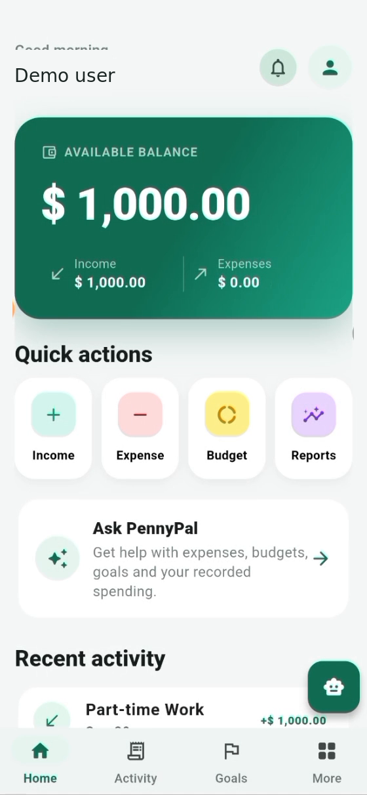
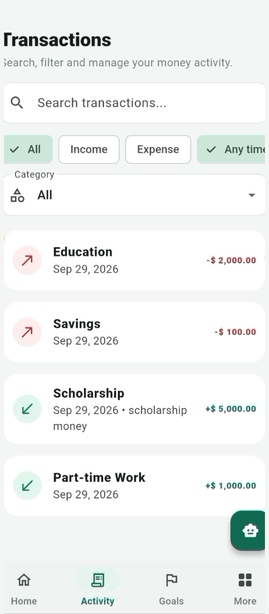
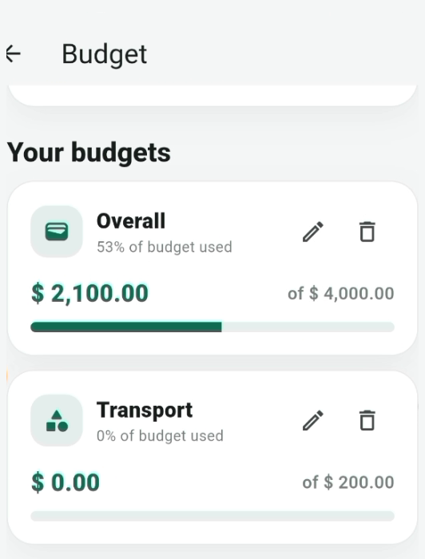
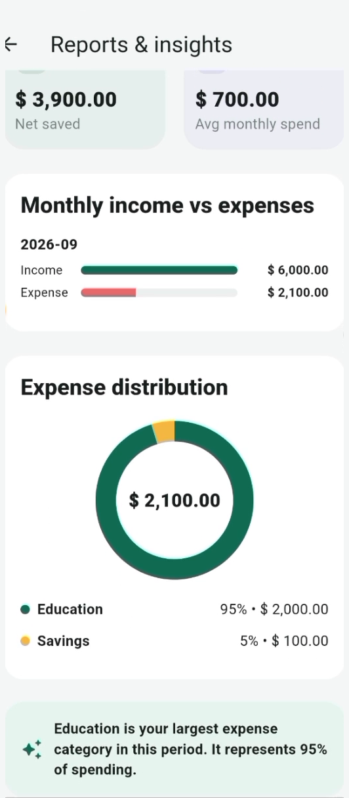
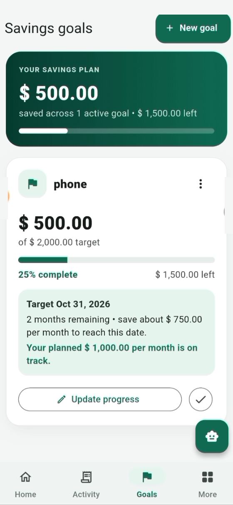
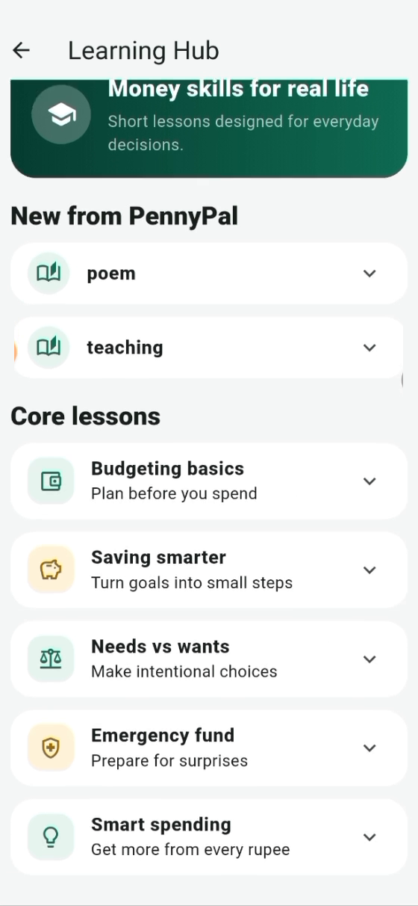
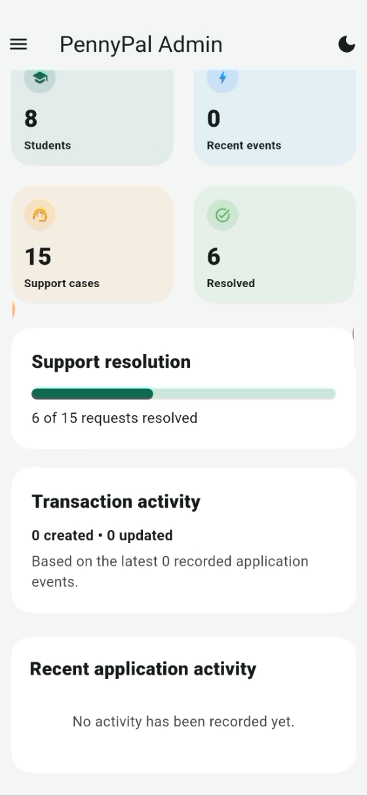
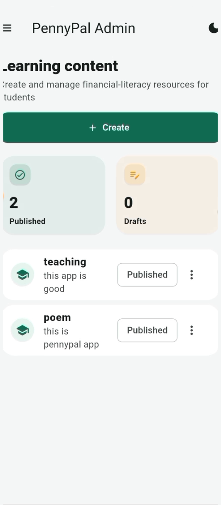

# PennyPal 💸

### Smart budgeting for student life

**PennyPal** is a cross-platform personal-finance application created for **Aptech TechWiz 7 — Multi-Platform App Computing**. It helps students understand where their money goes, build better spending habits, and work toward savings goals.

**Built with:** Flutter · Dart · Firebase Authentication · Cloud Firestore · Firebase Cloud Functions

**Project:** Completed competition submission · Open-source portfolio project

---

## 📱 App screenshots

*Actual screenshots captured from the PennyPal competition demonstration, using demonstration data.*

| Student Dashboard | Transactions | Budgets |
| :---: | :---: | :---: |
|  |  |  |

| Spending Reports | Savings Goals | Learning Hub |
| :---: | :---: | :---: |
|  |  |  |

| Admin Dashboard | Learning Content Management |
| :---: | :---: |
|  |  |

## ✨ What PennyPal does

- **Income and expense tracking** — Add, edit, search, and filter transactions.
- **Smart budgets** — Set monthly and category spending limits with progress and threshold notifications.
- **Savings goals** — Set targets and track how much has been saved.
- **Visual reports** — Explore balances, spending patterns, and category breakdowns.
- **Financial Learning Hub** — Learn everyday money-management concepts.
- **PennyPal guidance** — Receive context-aware, rule-based financial education tips.
- **Personalisation** — Currency preferences, light/dark themes, and notification settings.
- **Authentication** — Email/password and Google Sign-In, email verification, and password recovery.
- **Administration** — Role-restricted views for managing users, support queries, announcements, and learning content.

## 🛠 Technology

| Component | Stack |
| --- | --- |
| Application UI | Flutter and Dart |
| Authentication | Firebase Authentication |
| Database | Cloud Firestore |
| Cloud services | Firebase Cloud Functions and Cloud Messaging |
| Preferences | Shared Preferences |
| Target platforms | Android, iOS, Web |
| Continuous integration | GitHub Actions |

## 🌐 Live demo

A public browser demo is **not yet available**. The screenshots above show the actual competition application. A demo link will be added here when hosting is configured and verified.

## 🚀 Run the project locally

Install a Flutter SDK compatible with `pubspec.yaml` and set up a Firebase project for your own testing. Firebase Authentication and Firestore require corresponding configuration.

```bash
git clone https://github.com/aymenmansoor/PennyPal.git
cd PennyPal
flutter pub get
flutter run -d chrome
```

To check the project:

```bash
flutter analyze
flutter test
flutter build web --release
```

The included Firebase configuration refers to the original development project. Use your own Firebase configuration and verify the security rules before connecting a new backend.

## 📁 Project structure

```text
lib/                Flutter app screens, models, services and widgets
android/            Android application
ios/                iOS application
web/                Flutter web application
functions/          Firebase Cloud Functions
test/               Flutter and rules tests
docs/screenshots/   Application screenshot gallery
docs/               Additional technical documentation
```

## 🏆 Project background

Developed for the **Aptech TechWiz 7** global competition in the **Multi-Platform App Computing** category. This repository showcases the completed project and subsequent improvements to testing, reliability, and documentation.

PennyPal is an educational finance-management project, not a banking, payment-processing, or investment-advice service.
