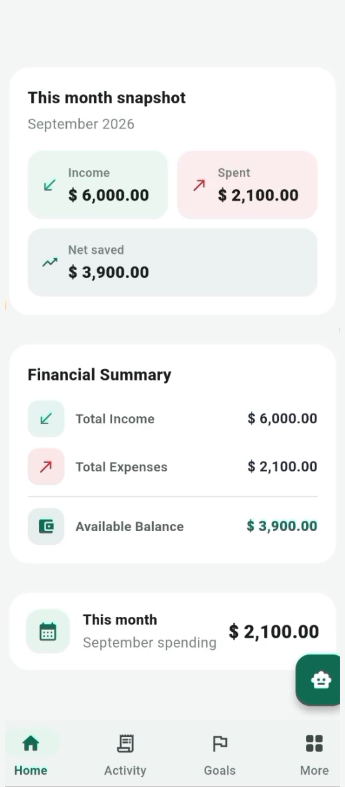

# PennyPal

**A student personal-finance application built with Flutter and Firebase.**

PennyPal was developed as a completed student competition project for **Aptech TechWiz 7** in the **Multi-Platform App Computing** category. This repository preserves the source code, documentation, and subsequent maintenance work as part of a software-development portfolio.

The application helps students record income and expenses, manage budgets, track savings goals, explore spending reports, and learn practical financial habits.

> **Project status:** Competition completed · Portfolio / maintenance repository. This is not advertised as a live financial service or a published app-store product.

## Features

### Student experience

- **Accounts:** Email/password registration and login, email verification, password reset, and Google Sign-In.
- **Transactions:** Record and manage income and expenses, search history, and filter transactions.
- **Dashboard:** Review balances, summaries, and recent activity.
- **Budgets:** Set monthly and category-based spending limits and receive threshold alerts.
- **Savings goals:** Track targets, contributions, and progress.
- **Reports:** View income, expenses, and category-based spending summaries.
- **Learning Hub:** Access educational financial-literacy content.
- **PennyPal assistant:** Receive contextual, rule-based guidance. This is not a hosted generative AI model.
- **Preferences and support:** Manage currency/theme preferences, notifications, and support requests.

### Administration

- Role-restricted administration screens.
- User, learning-content, support-query, and announcement management.
- Administrative analytics and role-based workflows.

## Technologies

| Area | Technology |
| --- | --- |
| Application | Flutter / Dart |
| Authentication | Firebase Authentication |
| Database | Cloud Firestore |
| Notifications | Firebase Cloud Messaging / Cloud Functions |
| Local preferences | Shared Preferences |
| Project targets | Android, iOS, Web |

## Screenshots

These are genuine frames from the PennyPal competition demonstration, cleaned
only to remove recorder controls and device chrome. The supplied test data uses
fictional financial values; review the visible display name before publishing.

| Dashboard | Transactions | Budgets |
| --- | --- | --- |
|  |  |  |

| Reports | Savings goals | Financial summary |
| --- | --- | --- |
|  |  |  |

| Learning Hub | Admin dashboard | Admin learning content |
| --- | --- | --- |
|  |  |  |

See the [screenshot guide](docs/screenshots/README.md) for provenance and
privacy precautions.

## Live demo

No public demo URL has been published yet. A verified Hosting URL will be added
after the isolated demo project is approved, deployed, and tested anonymously.
The launch and GitHub profile handoff is documented in
[`docs/PORTFOLIO_DEMO.md`](docs/PORTFOLIO_DEMO.md).

## Repository layout

```text
lib/                 Flutter application source
android/             Android project
ios/                 iOS project
web/                 Web project
functions/           Firebase Cloud Functions
test/                Flutter tests
docs/                Technical documentation and screenshot guidance
firestore.rules      Firestore access rules
firestore.indexes.json
firebase.json
```

## Run locally

A compatible Flutter SDK and a correctly configured Firebase project are required. Running this repository against your own Firebase project may require Authentication providers, Firestore rules, and other services to be configured.

```bash
git clone https://github.com/aymenmansoor/PennyPal.git
cd PennyPal
flutter pub get
flutter run -d chrome
```

Review Firebase configuration before running the app; do not assume that the repository includes credentials or access to a working backend.

## Checks

```bash
flutter analyze
flutter test
flutter build web --release
```

The repository also contains automated tests for Firestore permissions and Cloud Function cleanup, with a GitHub Actions CI workflow on the maintenance branch. Passing automated tests does not prove all live Firebase workflows work in every environment.

## Maintenance notes

The competition version has been followed by maintenance work focusing on Firestore validation, account deletion, admin support handling, and regression tests. Review the repository history and pull requests to distinguish the original submission from subsequent improvements.

Additional documentation is available for [account deletion](docs/ACCOUNT_DELETION.md), [web deployment considerations](docs/PHASE3_WEB_DEMO.md), and [Android release considerations](docs/ANDROID_RELEASE.md). These are reference materials, **not a commitment to release or deploy PennyPal**.

The original admin support-reply error was reported in use but has not been reproduced in emulator tests; production behaviour remains unverified.

## Educational scope

PennyPal is an educational and portfolio project. It does not connect to bank accounts, hold or transfer funds, process card payments, or provide professional financial or investment advice.

Avoid committing credentials, service-account private keys, or real users' financial records.

## Project context

**Competition:** Aptech TechWiz 7  
**Category:** Multi-Platform App Computing  
**Status:** Completed competition project, preserved for portfolio and maintenance.
